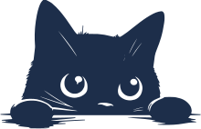
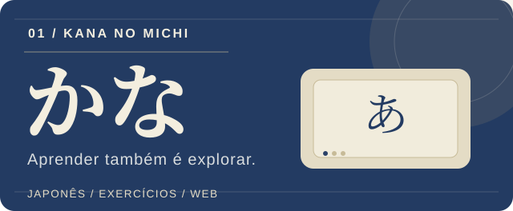
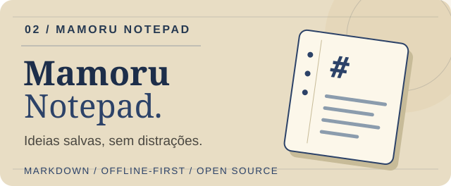
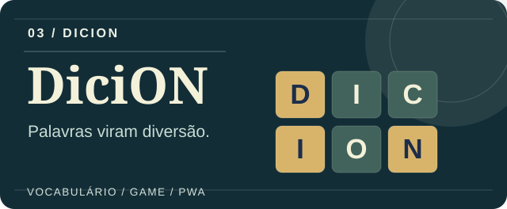
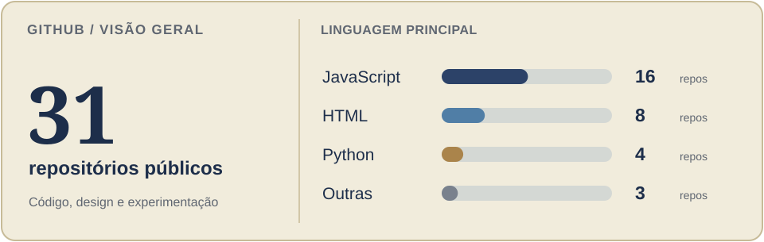

<!-- Perfil pessoal / Christian5910. Ícones originais extraídos das páginas habilidades.html e contato.html do portfólio.
O gatinho SVG é o original fornecido pelo autor, com cores para os temas claro e escuro.
Estatísticas: linguagem principal de cada repositório público, não tempo de programação. -->

<h1>Olá, sou o Christian <picture><source media="(prefers-color-scheme: dark)" srcset="./assets/mascot/cat-dark.svg"><source media="(prefers-color-scheme: light)" srcset="./assets/mascot/cat.svg"></picture></h1>

<strong>Designer &amp; Desenvolvedor Full Stack</strong>

Gosto de transformar ideias em experiências digitais: um pouco de design, um pouco de código e uma boa dose de curiosidade.

Belo Horizonte, MG · Interfaces, ferramentas e jogos · Aprendizado contínuo

---

##  Um pouco sobre mim

Sou um desenvolvedor que gosta de trabalhar no **projeto inteiro**, da lógica aos detalhes da interface. Procuro combinar **usabilidade, identidade visual e soluções práticas**, sem perder a diversão de experimentar.

 <b>Design:</b> interfaces acessíveis e cuidadosas, com personalidade.

 <b>Desenvolvimento:</b> aplicações web, PWAs e ferramentas offline-first.

 <b>Estudos:</b> programação, educação, língua e cultura japonesa.

 <b>Além do teclado:</b> música, jogos e projetos criativos.

---

##  Projetos em destaque

<table>
  <tr>
    <td width="50%" valign="top" align="center">
 
<h3>Kana no Michi · Engine</h3>

Aprendizado interativo de <b>hiragana e katakana</b>, com exercícios e uma identidade visual inspirada no Japão.

 
</td>
    <td width="50%" valign="top" align="center">
 
<h3>Mamoru Notepad</h3>

Editor de <b>Markdown</b> open source, pensado para escrever e organizar arquivos locais.

</td>
  </tr>
  <tr>
    <td width="50%" valign="top" align="center">
 
<h3>DiciON</h3>

Um jogo de palavras para expandir o vocabulário e brincar com a linguagem.

 
</td>
    <td width="50%" valign="top" align="center">
 
<h3>Currículo Guard</h3>

Análise de currículos em PDF com atenção a injeção de prompt e revisão humana auditável.

</td>
  </tr>
</table>

---

##  Jogos, ferramentas e experimentos

<table>
 <tr><th align="center">Jogos</th><th align="center">Ferramentas e estudos</th></tr>
 <tr>
  <td width="50%" align="center" valign="top">
 10 modos de Hanafuda

 Go para navegador

 Xadrez japonês

 Xadrez no estilo ON!

 Jogos de paciência
</td>
  <td width="50%" align="center" valign="top">
 Laboratório de interfaces

 Arte de imagem em Braille

 Base para apps offline

 Relógio em pixel art

 Qualidade de interfaces
</td>
 </tr>
</table>

  

---

##  Tecnologias e ferramentas

  
<b>Web e interfaces</b>

  

  
<b>Aplicações e dados</b>

  

  
<b>Ferramentas de trabalho</b>

  

---

##  GitHub em números

  <picture>
    <source media="(prefers-color-scheme: dark)" srcset="./assets/stats-dark.svg">
    <source media="(prefers-color-scheme: light)" srcset="./assets/stats-light.svg">
    
  </picture>
   
  Dados públicos, gráficos locais e atualização semanal automática. A linguagem exibida é a principal de cada repositório, não a porcentagem de linhas de código.

---

  
<b>Obrigado pela visita! 🐝</b>

  Design, código e curiosidade. Até a próxima! :3

