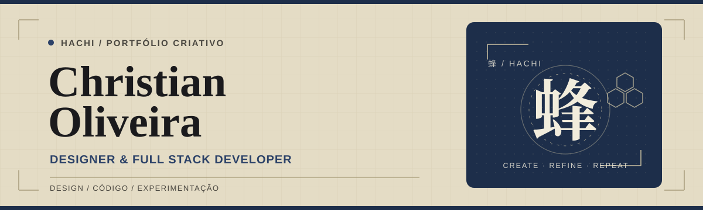

<!-- Perfil GitHub • Identidade visual inspirada no Kana no Michi -->

  <picture>
    <source media="(prefers-color-scheme: dark)" srcset="./assets/header-dark.svg">
    <source media="(prefers-color-scheme: light)" srcset="./assets/header.svg">
    
  </picture>

   

  <strong>Transformo ideias em experiências digitais — da primeira linha de código ao último detalhe da interface.</strong>

    

  
  
  
  

    
  📍 Belo Horizonte, MG &nbsp;·&nbsp; 🎨 Design & desenvolvimento &nbsp;·&nbsp; 🌱 Sempre aprendendo

---

## 01 · Sobre mim `自己紹介`

Olá! Sou **Christian Oliveira**, designer e desenvolvedor **Full Stack**. Gosto de construir projetos de ponta a ponta, unindo a lógica do desenvolvimento ao cuidado com a experiência de quem vai usar o produto.

Meu trabalho passa por **interfaces, aplicações web, PWAs, ferramentas e experimentos interativos**. Tenho um carinho especial por projetos educacionais, pela cultura japonesa e por tudo o que permite aprender algo novo enquanto se cria.

> **Meu princípio:** uma boa interface precisa ser bonita, mas principalmente clara, acessível e útil.

<table>
  <tr>
    <td width="33%" align="center"><b>✦ Design</b> Identidade visual, UI e UX</td>
    <td width="33%" align="center"><b>⌘ Desenvolvimento</b> Web, aplicações e ferramentas</td>
    <td width="33%" align="center"><b>文 Aprendizado</b> Educação, idiomas e cultura</td>
  </tr>
</table>

## 02 · Projetos em destaque `制作物`

<table>
  <tr>
    <td width="50%" valign="top">
      <h3>🌸 <a href="https://github.com/Christian5910/Kana-no-Michi_ENGINE">Kana no Michi · Engine</a></h3>
      
Motor independente de exercícios de <b>hiragana e katakana</b>, parte do universo Kana no Michi. Aprender japonês com interatividade e atenção ao visual.

      
<a href="https://kana-no-michi-engine.netlify.app/">↗ Experimentar</a> · <code>JavaScript</code> <code>Educação</code>

    </td>
    <td width="50%" valign="top">
      <h3>📝 <a href="https://github.com/Christian5910/Mamoru-Notepad">Mamoru Notepad</a></h3>
      
Editor de <b>Markdown</b> open source, com proposta offline-first, armazenamento local e uma interface pensada para quem escreve e organiza ideias.

      
<a href="https://github.com/Christian5910/Mamoru-Notepad">↗ Ver repositório</a> · <code>JavaScript</code> <code>Markdown</code>

    </td>
  </tr>
  <tr>
    <td width="50%" valign="top">
      <h3>🔠 <a href="https://github.com/Christian5910/DiciON">DiciON</a></h3>
      
Jogo de adivinhação de palavras para exercitar o vocabulário. Um projeto que mistura <b>jogos, linguagem e desenvolvimento web</b>.

      
<a href="https://dicion.netlify.app/">↗ Jogar</a> · <code>JavaScript</code> <code>PWA</code>

    </td>
    <td width="50%" valign="top">
      <h3>🛡️ <a href="https://github.com/Christian5910/Curriculo-Guard">Currículo Guard</a></h3>
      
Ferramenta em <b>Python</b> para inspecionar currículos em PDF, sinalizar possíveis injeções de prompt e apoiar uma revisão humana auditável.

      
<a href="https://github.com/Christian5910/Curriculo-Guard">↗ Ver repositório</a> · <code>Python</code> <code>Segurança</code>

    </td>
  </tr>
  <tr>
    <td width="50%" valign="top">
      <h3>🎨 <a href="https://github.com/Christian5910/Design_Lab">Designer Lab</a></h3>
      
Espaço para explorar conceitos de design e criar interfaces com mais intenção, do estudo de cores à composição visual.

      
<a href="https://designer-lab.netlify.app/">↗ Visitar</a> · <code>HTML</code> <code>CSS</code>

    </td>
    <td width="50%" valign="top">
      <h3>🐈 <a href="https://github.com/Christian5910/CatGirlClock">Cat Girl Clock</a></h3>
      
Relógio para Android com estética <b>pixel art</b>, widgets personalizáveis e suporte ao modo de carregamento.

      
<a href="https://github.com/Christian5910/CatGirlClock">↗ Ver repositório</a> · <code>Java</code> <code>Android</code>

    </td>
  </tr>
</table>

### 🎴 Jogos e experimentos

Além dos projetos principais, gosto de desenvolver jogos clássicos e experiências que funcionam no navegador:

- **[HanafudaON](https://github.com/Christian5910/HanafudaON)** — dez modos de Hanafuda reunidos em um só projeto.
- **[IgoON](https://github.com/Christian5910/IgoON)** · **[ShogiON](https://github.com/Christian5910/ShogiON)** · **[ChezzON](https://github.com/Christian5910/ChezzON)** — jogos de estratégia no estilo ON!.
- **[PaciON](https://github.com/Christian5910/PaciON)** — coleção de jogos de paciência.
- **[ASCII Braille](https://github.com/Christian5910/ASCII-art)** — imagens transformadas em arte de caracteres Braille, direto no navegador.
- **[PWA Model](https://github.com/Christian5910/PWA-Model)** — modelo de PWA offline-first, instalável e sem frameworks.

<b>☞ <a href="https://github.com/Christian5910?tab=repositories">Explorar todos os repositórios</a> · <a href="https://chris-speccy.netlify.app">Visitar meu portfólio</a></b>

---

## 03 · Tecnologias `技術`

  
<b>Front-end & experiência</b>

  
  
  
  
  
  

  
<b>Back-end & dados</b>

  
  
  
  

  
<b>Ferramentas & publicação</b>

  
  
  
  
  

---

## 04 · GitHub em números `記録`

  
  

  
<b>📈 Ver histórico de contribuições</b>

   
  

As estatísticas são geradas por serviços externos e podem ficar temporariamente indisponíveis.

---

  <b>蜂 · HACHI</b> — feito com atenção aos detalhes, curiosidade e um pouco de mel 🐝
   
  Obrigado pela visita! · またね :3

