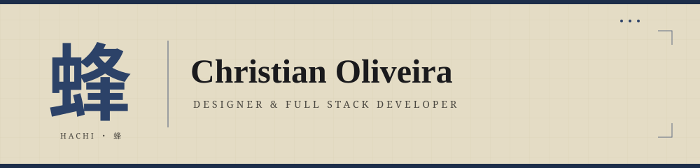

 

  

Belo Horizonte · MG · GMT-3 · <b>Disponível para projetos</b>

---

## 蜂 ・ Sobre mim

Sou **Christian Oliveira**, Designer e Desenvolvedor **Full Stack**. Minha trajetória se consolidou na prática — construindo projetos reais com olhar atento aos detalhes, evolução técnica constante e compromisso com a qualidade em cada entrega.

Gosto de assumir projetos **de ponta a ponta**, integrando a arquitetura do back-end aos ajustes finos de interface no front-end. Para mim, a criatividade é essencial, mas precisa estar construída sobre uma base sólida de **usabilidade**.

> *"Um projeto não termina quando chega a um fim definitivo — termina quando alcança estabilidade e cumpre com excelência o propósito para o qual foi criado."*

---

## 技 ・ Tecnologias

**Front-end**

**Back-end & Dados**

**Ferramentas & Deploy**

---

## 作 ・ Projetos em destaque

| Projeto | Descrição | Stack |
| :--- | :--- | :--- |
| 🐝 [**Portfólio Pessoal**](https://chris-speccy.netlify.app) | Centralização de projetos com interface minimalista, temas claro/escuro e PWA. | `HTML/CSS/JS` · `PWA` |
| 🤖 [**Luna AI**](https://ialuna.netlify.app) | Assistente virtual com personalidade própria, sobre múltiplos modelos de IA gratuitos. | `JS` · `API` · `AI` |
| 🎨 [**Arte em Cores**](https://arteemcores.netlify.app) | E-commerce de produtos artesanais com catálogo dinâmico e painel administrativo. | `Supabase` · `E-commerce` |
| 🧪 [**Designer Lab**](https://designer-lab.netlify.app) | Plataforma educativa com simuladores práticos de tipografia, cor e composição. | `HTML/CSS/JS` · `PWA` |
| 🐈 [**Cat Girl Clock**](https://github.com/Christian5910/CatGirlClock) | Relógio Android nativo em Java com widgets interativos e Pixel Art. | `Java` · `Android` |
| 点 [**ASCII Braile**](https://ascii-braile.netlify.app) | Conversor de imagens para arte ASCII com caracteres Braille, 4 algoritmos de dithering. | `TypeScript` · `PWA` |

> Mais em **[chris-speccy.netlify.app](https://chris-speccy.netlify.app)**

---

## 統 ・ Estatísticas

 

---

蜂 ・ feito com atenção, café e um pouco de mel 🐝

